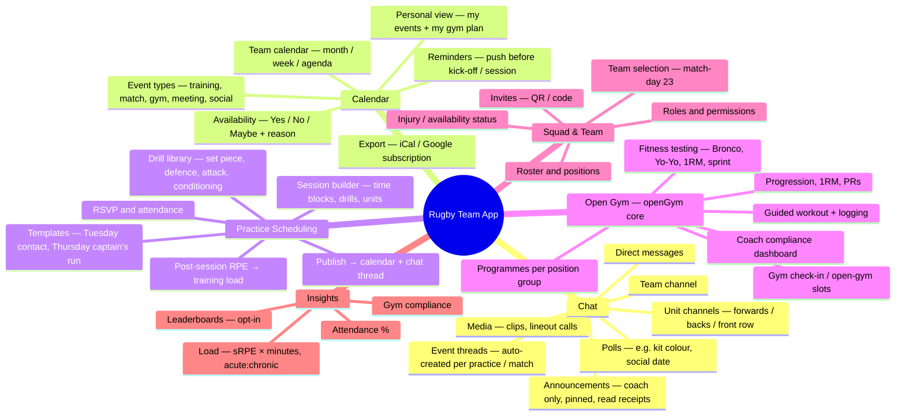
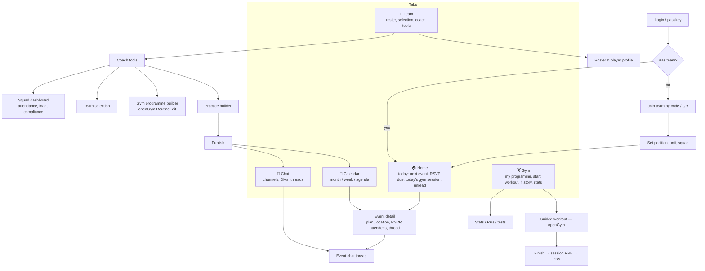
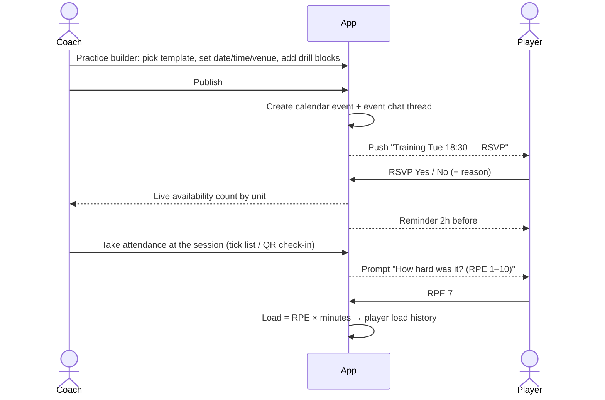
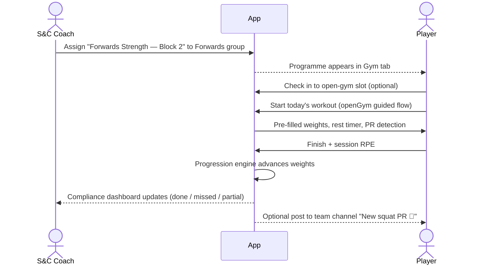
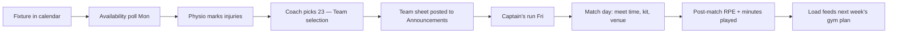
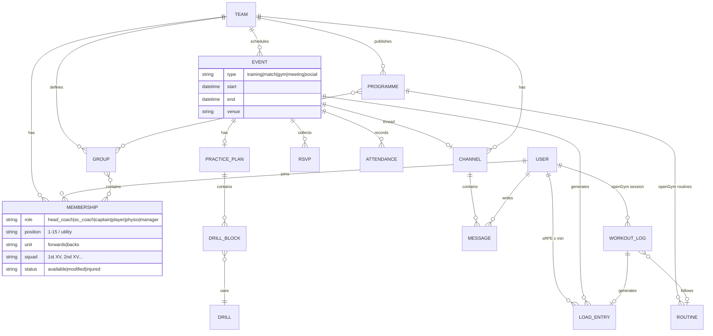
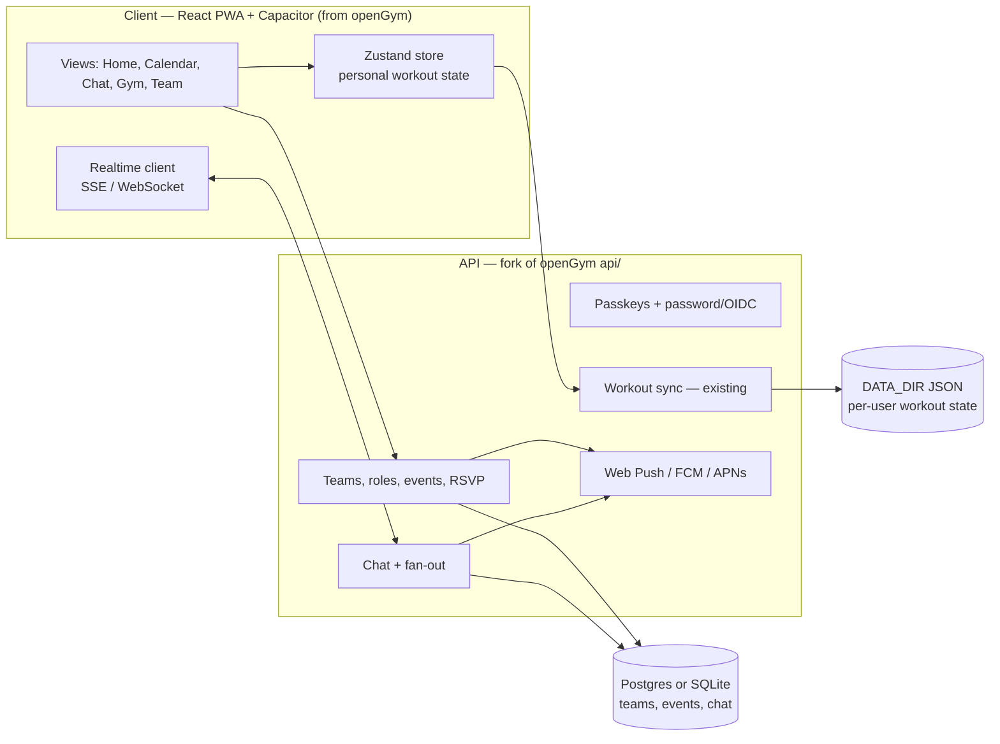

# Rugby Team App — Plan

> Status: **planning only**. No code yet. Base project: [openGym](https://github.com/DuarteSantos8/openGym) (self-hosted gym tracker, AGPL-3.0).
> Visual map: [[UX & Feature Map.canvas]]

## 1. What we're building

One app for a rugby squad that covers four things:

| Pillar | What it does | Where it comes from |
|---|---|---|
| **Chat** | Team, unit (forwards / backs) and DM channels, announcements, threads that hang off an event | New |
| **Calendar** | Fixtures, trainings, gym slots, socials, availability; one team calendar plus a personal view | New, with openGym's weekday plan as a starting point |
| **Practice scheduling** | Coaches build sessions (drills, time blocks, units), publish them, players RSVP, coaches take attendance | New |
| **Workout tracking (open gym)** | S&C programmes assigned per position group, players log in the gym, coaches see who did what | **openGym**: guided workouts, progression, 1RM, PRs, rest timer, stats |

## 2. Starting from openGym: what we keep and what we add

**Keep as-is (training engine):**
- Exercise library (5,600+), routines, rotation plans, supersets, timed and cardio sets
- Guided workout screen, rest timer, plate math, RIR/RPE effort
- Progression engine (`lib/progression.js`), 1RM (`lib/onerm.js`), recovery model, stats/heatmap
- Passkey login, PWA + Capacitor (Android/iOS), Web Push notifications
- Optional AI coach + read-only MCP bridge

**Gaps for a team app:**
- openGym is **single-user**. Each user has their own `state-<uid>.json`, and there's no concept of a team, role or shared data.
- Storage is **flat JSON files**. That's fine for one lifter. It won't hold up under chat volume or many concurrent team writes.
- There's **no real-time channel**. Sync is debounced push/pull of the whole state.
- The upstream roadmap edges closer: *groups* (v1.4.4), *sharing & gyms* (v1.4.5), the *trainer role* where one person writes another's plan (v1.4.7), and *database storage* (later). It's worth tracking or contributing to rather than diverging.

**Decision to make (recommendation: fork + team layer):**
1. **Fork openGym and add a team layer.** Reuse the training engine and UI. Add `teams`, roles, events, chat and a real database. *Recommended*: the workout piece is the hardest part and it's already done.
2. **Separate team app plus openGym as a linked service.** A cleaner split, but two logins and two apps for players.
3. **Greenfield.** Only worth it if we drop self-hosting.

> AGPL-3.0: if we run a modified openGym as a network service, we must publish our source. Fine for a club app, but decide it up front.

## 3. Users and roles

| Role | Main jobs |
|---|---|
| **Head coach** | Plans the season, builds practices, selects the team, posts announcements |
| **S&C coach** | Writes gym programmes per position group, watches compliance and load |
| **Captain / leadership** | Posts in chat, nudges attendance, sees the squad view |
| **Player** | Sees schedule, RSVPs, chats, logs open-gym workouts, reports wellness |
| **Physio / medic** | Sets injury status (available / modified / out), return-to-play notes |
| **Team manager / admin** | Roster, invites, fixtures, venues, permissions |

Rugby-specific attributes on a player: **position** (1–15 + utility), **unit** (forwards / backs; front row, back row, halves, etc.), **squad** (1st XV, 2nd XV, U18…) and **availability status**.

## 4. Feature map

## 5. Information architecture (navigation)

Bottom tab bar, five tabs. That's the same pattern openGym uses (`components/TabBar.jsx`).

## 6. Key user flows

### 6a. Coach schedules a practice → player turns up

### 6b. Player does open gym

### 6c. Match week

## 7. Feature → screen matrix

| Feature | Home | Calendar | Chat | Gym | Team | Role |
|---|:-:|:-:|:-:|:-:|:-:|---|
| Next event card + RSVP | ● | ● | | | | all |
| Event chat thread | | ● | ● | | | all |
| Announcements | ● | | ● | | | coach post / all read |
| Practice builder | | ● | | | ● | coach |
| Attendance | | ● | | | ● | coach |
| Gym programme | ● | ○ | | ● | ● | S&C writes / player runs |
| Guided workout (openGym) | ● | | | ● | | player |
| Compliance + load dashboard | | | | | ● | coaches |
| Injury status | | ○ | | | ● | physio |
| Team selection | | ● | ● | | ● | coach |
| Fitness tests | | ● | | ● | ● | S&C |

● primary · ○ secondary

## 8. Data model (draft)

## 9. Architecture sketch

Notes:
- **Leave workout state where it is at first** (per-user JSON plus openGym's sync). Put the new team data in a real DB. Move workout logs into the DB later if the coach dashboards need cross-player queries. Upstream's "database storage" milestone may get there first.
- **Real-time chat**: SSE plus POST works with zero new deps on `node:http`. A WebSocket lib is the alternative. openGym is strict about dependencies, which matters if we want to merge upstream.
- **Push**: reuse openGym's Web Push. Native shells need FCM/APNs for reliability.

## 10. Phased roadmap

| Phase | Scope | Exit criteria |
|---|---|---|
| **0 — Foundations** | Fork, team + membership + roles, invite by code/QR, roster, DB added | Coach creates team, 30 players join |
| **1 — Calendar & practice (MVP)** | Events, RSVP, reminders, practice builder + templates, attendance | One full training week runs through the app |
| **2 — Chat** | Team, unit and DM channels, announcements, event threads, push | WhatsApp group not needed for logistics |
| **3 — Open gym for teams** | Programmes per group (built on openGym), compliance dashboard, session RPE, check-in | S&C sees weekly compliance per unit |
| **4 — Match week & insights** | Selection/team sheet, injury status, load (sRPE, ACWR), fitness tests, iCal export | Coach plans match week end-to-end |
| **Later** | Video clips, polls, leaderboards, GPS/wearable import, multi-squad clubs, payments/subs | — |

## 11. Open questions

1. Self-hosted per club (openGym's model) or one hosted service for many teams?
2. Fork and diverge, or contribute the team layer upstream (groups, trainer role, sharing are already on their roadmap)?
3. Does chat need to be E2E encrypted, or is server-side storage OK? (Minors/U18 squads raise safeguarding rules: no adult↔minor DMs, message retention.)
4. Which DB: SQLite (simple self-host) or Postgres (hosted, multi-team)?
5. Will players accept coaches seeing their gym logs? We need clear privacy controls. Default: coaches see team-programme sessions only.
6. Integrations: Google Calendar sync, wearables (GPS/heart rate), club management systems?

## 12. Going commercial: workout tracking as one module

Visual version: https://claude.ai/artifact/6sVCMYiqccQW4cLhW2sfdT

**Reframe:** the product is a rugby team platform. Workout tracking is one module beside chat, schedule, practice planner, selection, welfare/load, club admin and payments. Every module runs on a shared core: identity, teams/roles, notifications, data, integrations and billing.

| Plan | Includes |
|---|---|
| Free | Chat, schedule, RSVP, roster, reminders |
| Pro (per team) | Practice planner, selection, workout tracking, welfare & load, coach dashboard |
| Club (per club) | Pro plus many squads, safeguarding roles, registration, payments, reports |

Revenue: subscriptions (coaches/clubs pay, players don't), a fee on in-app payments, a programme marketplace for S&C coaches, and later licences for unions and leagues.

**Licensing (summary of openGym's LICENSE/NOTICE.md, not legal advice):**
- Code is AGPL-3.0. Selling a hosted modified version means publishing all of its source, including anything linked into it.
- The exercise animations are Gym visual's, not AGPL. NOTICE.md says a commercial fork needs its own licence from gymvisual.com.
- **Recommendation:** build our own workout module and use openGym only as a UX reference. Alternatives: a dual licence from the author (only covers code he owns), or ship everything as AGPL open-core and sell hosting.
